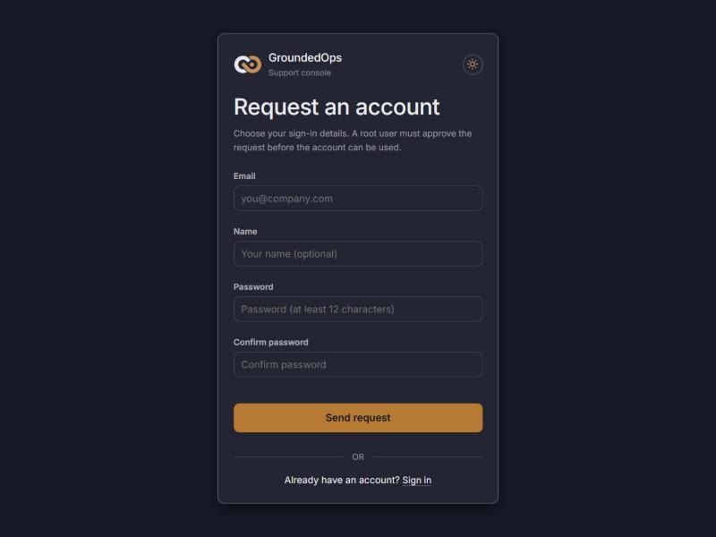
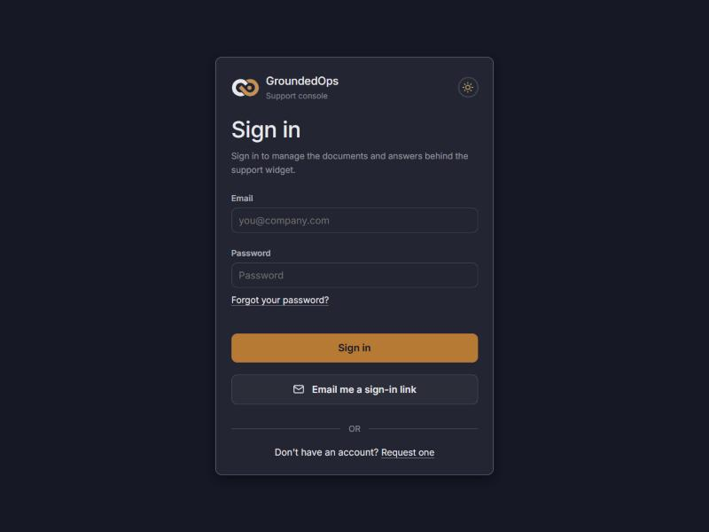
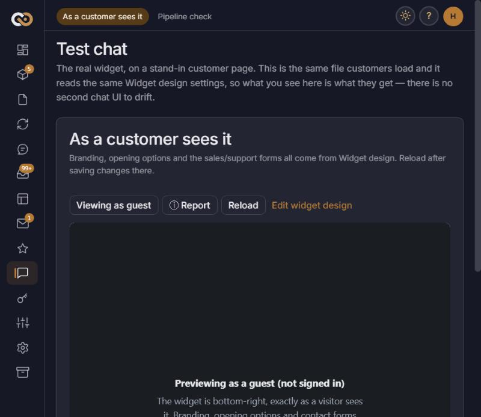
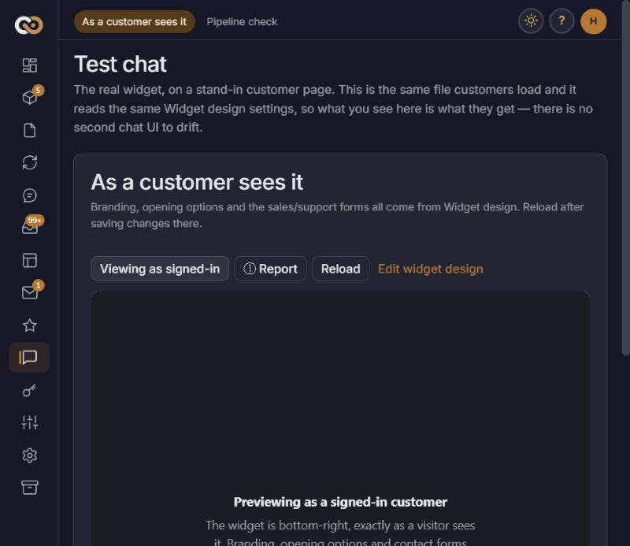
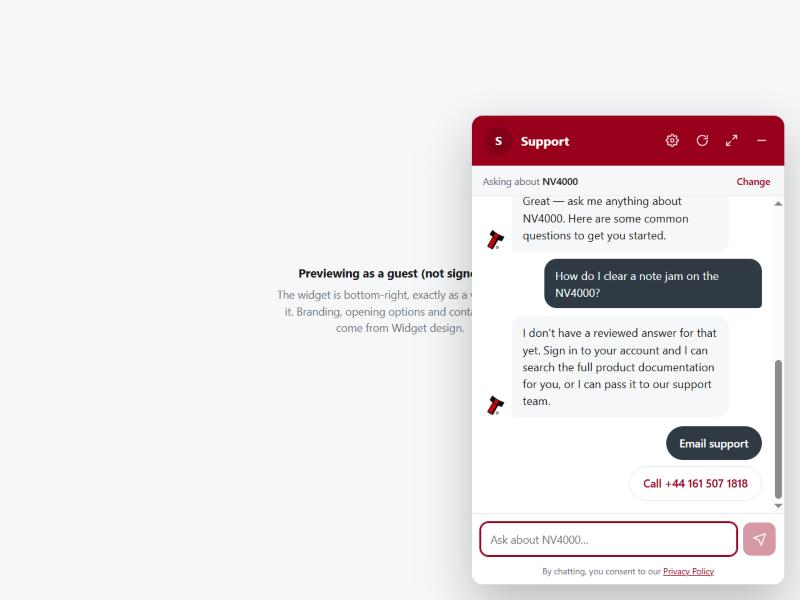
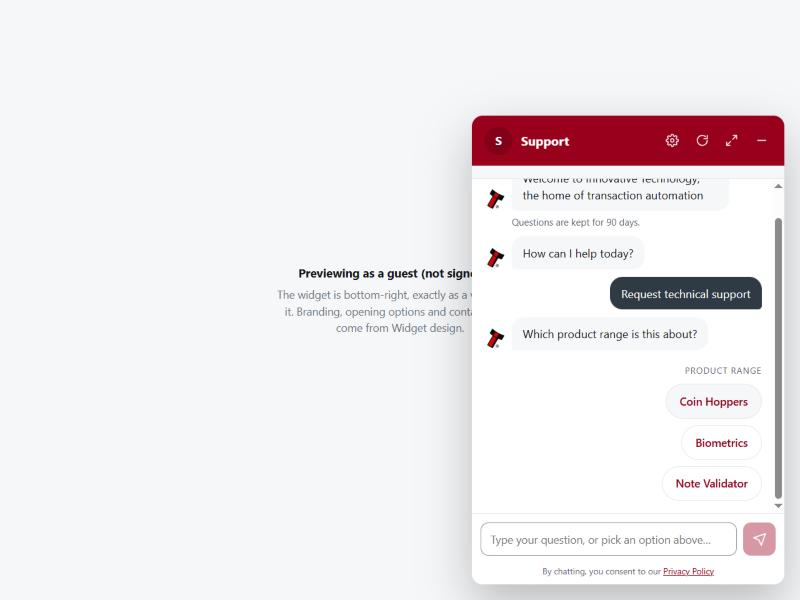
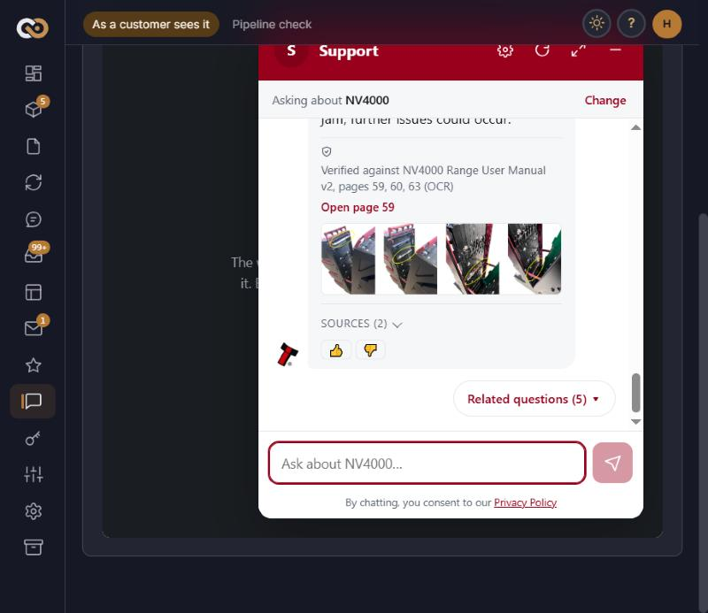
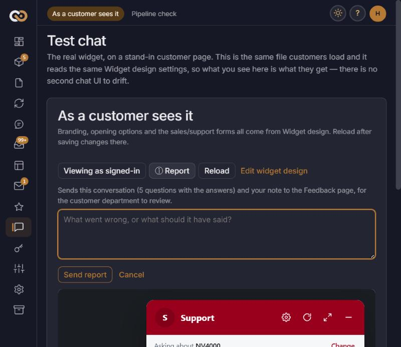

# Testing the assistant — a guide for support staff

Test the assistant **as a signed-in customer**, and report anything it gets
wrong with the **ⓘ Report** button — that button sends the whole
conversation with your note, so you never have to screenshot or copy
anything.

A shareable version of this guide, with the same screenshots, is published
as a Claude doc — ask Hamza for the link.

---

## 1. Getting an account

You request your own account — nobody has to create one for you.

1. Go to **http://10.10.15.170:8000/admin**
2. Click **Request one** at the bottom of the sign-in box
3. Choose your email, name and a password of at least 12 characters
4. Click **Send request**

*The request form. You pick your own password — nobody sends you one.*

A root user then approves it. **You will not be able to sign in straight
away** — wait for the nod.

**Ask for a Support-level account.** Say so when you request it, or tell
Hamza. This matters more than it sounds: a Basic account is permanently
stuck in the guest view described in section 3, and cannot do the testing
we actually need.

---

## 2. Getting in

The address is **http://10.10.15.170:8000/admin**.

*The sign-in box. "Request one", at the bottom, is how you ask for an
account.*

**You must be on the company network.** Working from home means the VPN has
to be connected first.

If the page will not load at all, **check the VPN before anything else.**
That is almost always the reason, and it will look exactly like the server
being down.

The console can take **10–15 seconds** to appear after you sign in, and
shows a blank screen while it loads. That is normal — wait rather than
reloading.

---

## 3. Always test as signed in — never as guest

**This is the one setting that decides whether your testing is worth
anything,** and the page does not start on the right one.

The assistant behaves completely differently depending on whether it thinks
it is talking to an anonymous website visitor or a signed-in customer:

| | What it does |
|---|---|
| **Guest** | Answers only from a short list of pre-approved answers. For anything else it says *"I don't have a reviewed answer for that yet"* and offers to email support. **It does not read the manuals at all.** |
| **Signed in** | Searches the full product documentation, answers from it, and shows you the manual pages it used. **This is what we need you to test.** |

On the **Test chat** page, the button at the top left of the chat starts on
**Viewing as guest**.

*How the page starts — **Viewing as guest**. Do not test in this state.*

**Click it so it reads "Viewing as signed-in", then test.**

*After one click — **Viewing as signed-in**. Now test.*

If the assistant tells you to sign in, or offers to email support, you are
still in guest mode. Click the button and ask again — that is not a bug and
is not worth reporting.

*Guest mode refusing a real question. If you see this, you are in the wrong
mode.*

If you cannot see that button at all, your account is Basic rather than
Support. Ask for it to be upgraded, because you cannot do useful testing
without it.

---

## 4. Asking questions

Open **Test chat** from the left-hand rail, switch to **Viewing as
signed-in** (section 3), then click **Ask about our products** at the
bottom right.

The chat opens with four options — *Speak to sales*, *Request technical
support*, *Find a product*, *Get spare parts & accessories*. For product
testing, choose **Request technical support**, then:

1. Pick the **product range** — Coin Hoppers, Biometrics or Note Validator
2. Pick the **model** — NV200, NV4000, BV50, NV201 Spectral, CBA9 and so
   on, or **Not sure — ask across the whole range**
3. Ask your question

*Picking the product range, then the model.*

**Change**, at the top of the chat, switches product without starting over.

Then test it properly:

- Ask real questions, in the words customers use — not tidied-up versions
- Follow-up questions work; carry the conversation on like a customer would
- Try the awkward ones: the vague question, the wrong model number, the
  thing the manual explains badly

**A good answer takes 30–60 seconds.** It tells you what it is doing as it
goes — *searching*, *reading the pages that matched*, *checking the answer
against the manual*. That is it doing the work properly, not hanging. The
first question after a quiet spell can be slower still.

*A proper signed-in answer: the manual pages it used, the pictures from
them, and the sources behind it. Check the answer against the page it cites
— that is the quickest way to catch a wrong one.*

---

## 5. Reporting problems

This is the part that matters. When an answer is wrong, incomplete or odd:

1. Click **ⓘ Report**, at the top of the Test chat page
2. Type what went wrong, or what it should have said
3. Click **Send report**

*The report box. It tells you how many questions it is sending with your
note.*

**The whole conversation goes with it automatically.** You do not need to
screenshot anything, copy the chat, or write out what you asked.

### Write it like this

| Good report | Why it works |
|---|---|
| "Wrong — the NV4000 clears from the top cover, not the cash box. Install manual page 14." | Says what is wrong **and** where the right answer is |
| "Didn't answer my question — it told me about the NV200 instead." | Names the actual failure |
| "Right answer, but it left out the power-isolation step." | Specific and checkable |

"Doesn't work" or "bad answer" cannot be acted on. One line of detail is
enough.

### Please do not email or Teams these

A report sent through the button carries the conversation with it, lands
where the people fixing it are looking, and gets checked against the
manuals. An email carries none of that and gets lost.

**One exception:** anything unsafe — a missing warning, a wrong voltage, a
wrong torque figure, a wrong isolation step — **report it in the tool and
message Hamza directly.** Those are treated as urgent rather than waiting
for the weekly review.

---

## 6. What to report, and what not to

**Worth reporting**

- Wrong facts: figures, part numbers, settings, procedures
- Says it cannot find something that **is** in the manual (while signed in
  — section 3)
- Answers about the wrong product or the wrong model
- Missing or wrong safety warnings — urgent, see section 5
- Tone that would embarrass us in front of a customer

**Not worth reporting**

- The *"I don't have a reviewed answer"* deflection **in guest mode** —
  that is guest mode working as designed
- A slow answer, or a slow first answer after a quiet spell — 30–60 seconds
  is normal
- Refusing to answer something that genuinely is not in the manuals — that
  is correct behaviour, not a failure
- Prices, stock levels, order status, lead times — it has no access to any
  of that and is not meant to

---

## 7. If something looks broken

| What you see | First thing to check |
|---|---|
| Page will not load at all | Is the VPN connected? That is almost always it |
| Blank screen after signing in | Wait 10–15 seconds — the console is still loading |
| Everything deflects to "email support" | You are in guest mode — section 3 |
| No "Viewing as guest" button | Your account is Basic, not Support — section 1 |
| "Sign in failed" | Your request may not be approved yet — ask Hamza |
| Answers take 30–60 seconds | Normal. It is reading the manuals |
| Nothing works and the VPN is fine | Tell Hamza; the server may be mid-update |

---

**Where your reports go:** the console's Feedback page, where they are read
against the manuals and turned into fixes. Problems reported by several
people get fixed first — so report a fault even if you think someone else
already has.
